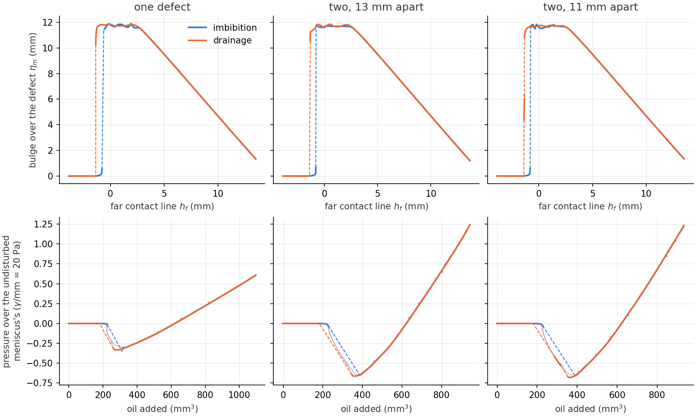
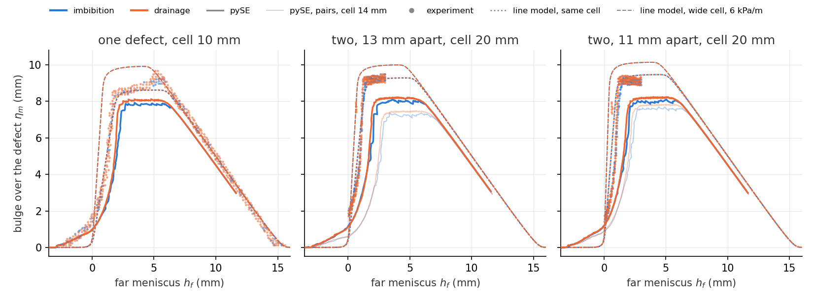

# Defects in a Hele-Shaw cell: when an interface jumps

An interface pushed slowly through a rough fracture or a porous medium sticks where
the walls hold it, then jumps. Each jump turns some of the work done on it into heat,
and that is where the hysteresis of capillary pressure against saturation comes from.

Holtzman et al. built the simplest case of this. They used a quasi-2D
**Hele-Shaw cell**: two plates 3.6 mm apart, with **defects** printed on one plate,
places 10 mm wide where the gap narrows. They pushed silicone oil in and out of the
cell by its pressure. Each defect alone is **weak**: the interface bulges over it and
back without a jump. Their line model predicts that two weak defects closer than a
critical separation act as one **strong** defect, which the interface crosses in
jumps. Dissipation then emerges from units that dissipate nothing on their own. In
their cell, one defect gave no hysteresis, a pair 13 mm apart (centre to centre) gave
a loop, and a pair 11 mm apart a wider one.

This page builds the cell in 3D and follows the experiment's three cases through
imbibition and drainage with pySE. The 3D cell includes the meniscus's shape across
the gap, its contact lines on both plates and gravity in the tilted cell. It finds:

* **Dissipation in the paper's order.** It grows from one defect to the pair 13 mm
  apart to the pair 11 mm apart, as in the experiment. The amounts are small, and
  part of them comes from the mesh.
* **Bulges about 1 mm lower than in the experiment.** Seen through the plates, as the
  experiment saw them, the meniscus's shape over the defects matches the
  experiment's.
* **Less sensitivity to the cell's width than the line model has.** The runs feel the
  cell's width about a third as much as the line model does.
* **No hysteresis in the line model.** The model gives no loop in any of the cells
  at the experiment's slope of capillary pressure.

The cell is in `docs/hele_shaw_helpers.py`. `tools/hele_shaw_figure.py` runs it and
draws the pictures.

## The upper plate as a curved wall

The defects come from Appendix D of the paper. Along a defect's ramp, 10 mm long, the
gap b narrows so that the capillary pressure 2γ/b rises linearly by 60 Pa. A plateau
5 mm long follows at the narrowest gap, 0.56 mm, and then the gap opens back to 3.6 mm.
The printed edges are smoothed over 0.25 mm here.

The upper plate is the surface z = b(x, y), a formula in x and y, and
{func}`~pysurfaceevolver.constraints.heightfield` makes it a wall. The wetted area,
the oil's volume under the plate and its weight there have no closed form as
integrals along the contact line. So `heightfield` tabulates them over a rectangle
and evaluates them in C as cubic splines, derivatives included. The lower plate is
the plane z = 0. The oil (contact angle 20°) fills the cell up to the meniscus, and
mirror planes at x = 0 and x = X stand for the rest of the cell.

Without gravity, a meniscus between parallel plates is a circular arc of radius
b/(2 cos θ), which gives a check of the curved wall. Here the defect spans the cell's
whole width, a channel 2 mm wide. A flat meniscus is relaxed at y = -4, where the gap
is the open 3.6 mm, and at y = 12, on the plateau. In the second start the ramp lies
between the plates' integrals' first row (y = -12) and the meniscus, so its volume
checks the tables along the ramp:

```python
import numpy as np
from hele_shaw_helpers import cell, contact_line, gap, meniscus

for y0 in (-4.0, 12.0):                          # the open cell; the plateau
    ev = cell(None, y0, width=2.0, nx=5, gravity=False)
    y = np.linspace(-12, y0, 200001)
    b = gap(y)
    exact = 2.0*np.sum((b[1:] + b[:-1])/2*np.diff(y))     # the oil up to y0
    print(f"start at y = {y0:g}: gap {b[-1]:.4f}, volume {ev.body(1).volume:.4f} "
          f"(exact {exact:.4f})")
    ev.relax(levels=2)
    p, dry = meniscus(b[-1])
    print(f"  relaxed: pressure {ev.body(1).pressure:.4f} (exact {p:.4f}), "
          f"contact line at y = {contact_line(ev):.3f} (exact {y0 + dry/b[-1]:.3f})")
```

```text
start at y = -4: gap 3.6000, volume 57.6000 (exact 57.6000)
  relaxed: pressure -0.5225 (exact -0.5221), contact line at y = -3.086 (exact -3.082)
start at y = 12: gap 0.5625, volume 113.0703 (exact 113.0703)
  relaxed: pressure -3.3414 (exact -3.3411), contact line at y = 12.140 (exact 12.143)
```

* **Pressures** agree to under a thousandth.
* **Contact lines** agree to 0.004 mm, the error of a mesh with 24 edges across the
  gap.
* **Volumes** agree to every digit shown, which checks the tables' integrals along
  the ramp.

## The three cells

Each run follows the experiment's cycle:

1. A flat meniscus starts 4 mm below the defects.
2. Oil goes in until the meniscus far from the defects is 13.5 mm up (the defects end
   at 15).
3. The oil is drawn back out to the start.

The runs control the volume, not the pressure. `recipes.arclength` steps the oil's
volume by 12 mm³, halved at most twice where a step finds no equilibrium. It makes
the changes of topology on the way: contact lines meeting, and dry patches opening on
the plate. Mirror planes bound each cell, at x = 0 and at x = 10 for one defect,
x = 14 for the pairs (and x = 20 for the pairs' wider cells in the next section).
The mesh is 1.5 times finer than the tool's default (`--fine 1.5`).

```text
OMP_NUM_THREADS=4 python tools/hele_shaw_figure.py run single 0   --rounding 0.25 --ds 12 --halvings 2 --width 10 --fine 1.5 --states 6
OMP_NUM_THREADS=4 python tools/hele_shaw_figure.py run pair13 6.5 --rounding 0.25 --ds 12 --halvings 2 --width 14 --fine 1.5
OMP_NUM_THREADS=4 python tools/hele_shaw_figure.py run pair11 5.5 --rounding 0.25 --ds 12 --halvings 2 --width 14 --fine 1.5 --states 6
OMP_NUM_THREADS=4 python tools/hele_shaw_figure.py run pair13 6.5 --rounding 0.25 --ds 12 --halvings 2 --width 20 --fine 1.5 --states 6 --out wider
OMP_NUM_THREADS=4 python tools/hele_shaw_figure.py run pair11 5.5 --rounding 0.25 --ds 12 --halvings 2 --width 20 --fine 1.5 --states 6 --out wider
python tools/hele_shaw_figure.py draw --wider wider
```



**Top row: the bulge over the defect.** As in the paper's figures, this is the bulge
of the meniscus over the defect, η<sub>m</sub>, against where the far meniscus is,
h<sub>f</sub>. The bulge is the meniscus at the middle of the defect less the
meniscus far from it. Both are taken where the meniscus meets the printed plate. The
experiment sees them differently; see the next section.

**Bottom row: the oil's pressure against its volume.** The plot shows the pressure
less that of the meniscus undisturbed: a line in the volume fitted while the defects
are still far (the first 100 mm³), which takes out gravity's steady rise.

**Jumps.** Under volume control, the path is continuous. The experiment controls the
pressure, and there the interface jumps wherever the pressure would have to fall
(the dashed segments). Each jump dissipates the area it cuts off under the pressure
curve. The table gives this dissipation over the cycle, and the part from
imbibition's jumps on the ramp, which start before h<sub>f</sub> reaches 4.6 mm, the
top of the steep climb:

| cell | jumps (imbibition + drainage) | dissipated over the cycle | of it, imbibition on the ramp |
|---|---|---|---|
| one defect | 24 + 30 | 0.16 γ mm² (3.2 nJ) | 0.05 γ mm² |
| two, 13 mm apart | 22 + 36 | 0.35 γ mm² (6.9 nJ) | 0.10 γ mm² |
| two, 11 mm apart | 30 + 38 | 0.42 γ mm² (8.3 nJ) | 0.15 γ mm² |

**What all three cells share.**

1. The bulge jumps to about 1 mm as the meniscus reaches the defect's foot
   (h<sub>f</sub> ≈ −1).
2. It climbs steeply as the meniscus rises up the ramp (h<sub>f</sub> 3.5 to 4.5).
3. It sits at 5.5–6.5 mm while the meniscus crosses the plateau.
4. It relaxes once the far meniscus passes the defect's end.

As in the experiment, the dissipation grows from one defect to the pair 13 mm apart
to the pair 11 mm apart. Drainage's curve parts from imbibition's where the bulge
climbs.

**How much of this is the mesh.** Most jumps come where the meniscus has stalled and a
remesh lets it go on: the contact lines hold on the mesh. The finer mesh shows which
part is the cell's:

* **One defect on the ramp:** 0.21 γ mm² on the default mesh (`--fine 1`), a quarter
  of that on the finer mesh. Most of it was the mesh's.
* **The pair 11 mm apart on the ramp:** 0.14 on the default mesh and 0.15 on the
  finer mesh. This part is the cell's.
* **Over the cycle:** 0.33, 0.41 and 0.43 γ mm² on the default mesh, most of it a
  sawtooth of small jumps.
* **The path a run takes:** the pair 13 mm apart with steps of 6 mm³ (`--ds 6`)
  dissipated 0.23 γ mm² over the cycle and 0.05 on the ramp. So the numbers carry
  about ±0.05 γ mm². The pair 11 mm apart stands clear of one defect; the pair 13 mm
  apart less so.
* **The cell's width:** in cells 20 mm wide, the pairs dissipated 0.28 and 0.27 γ mm²
  over the cycle (21 + 28 and 23 + 35 jumps), against 0.35 and 0.42 in cells 14 mm
  wide.
* **The offset on the plateau:** drainage's bulge stays 0.1 mm above imbibition's
  there in all three cells (0.12 on the default mesh), while the experiment's curves
  lie on each other. That offset is likely the mesh's too.

## Against the experiment and the line model

**Seen through the plates.** The experiment films the cell through its plates, and
the far meniscus doesn't stand straight across the gap. Gravity across the 3.6 mm gap
(ρg cos 38° · 3.6 mm ≈ 26 Pa) outweighs the meniscus's own capillary pressure
(2γ cos θ/b ≈ 10 Pa), so the meniscus leans. Where it meets the printed (lower)
plate, it runs 1.9 mm ahead of where it crosses half the gap. Over a defect, where the
gap is 0.6 mm, it hardly leans. Measured where the meniscus crosses half the gap,
h<sub>f</sub> comes out 1.9 mm smaller and the bulge 1.7 mm larger than in the figure
above.



Every curve here is measured that way (`hele_shaw_helpers.half_gap` for the runs):

* **pySE (solid lines):** for the pairs, runs in cells 20 mm wide, which are the same
  but for `--width 20`. The runs in cells 14 mm wide are faint behind them.
* **Experiment (dots):** read off the paper's Figs. 9b and 7, in
  `_static/hele_shaw_experiment.csv`.
* **Line model (dotted and dashed lines):** the paper's line model, solved in
  `hele_shaw_helpers.line_model`, described below.

Without `--wider`, `draw` uses the curves kept in `_static/hele_shaw.npz`.

**The shape matches.** One defect's bulge falls off the defect's end along the
experiment's line. It even rises a little before the meniscus reaches the defect
(h<sub>f</sub> −2.5 to 0), which the paper marks as an effect of the meniscus
spanning the gap. It climbs about 0.5 mm of h<sub>f</sub> later than the experiment's.

**The bulge falls about 1 mm short.** Over the plateau, the bulges are:

* one defect: 7.9–8.1 mm, against the experiment's 8.5–9 mm (Fig. 9b);
* the pairs in cells 20 mm wide: 8.1 mm each, against about 9.2 mm (Fig. 7);
* the pairs in cells 14 mm wide: 7.4 and 7.7 mm.

**The line model.** Holtzman et al.'s model treats the meniscus as a line with a
capillary length ℓ<sub>c</sub> = √(γ/ρg<sub>e</sub>), here 1.9 mm (ρ = 930 kg/m³,
γ = 20 mN/m, g<sub>e</sub> = g sin 38°). It is solved here for these defects, with
their edges rounded as here. The solution follows the cycle from one equilibrium to
the next as h<sub>f</sub> rises and falls. Its slope of capillary pressure is
Π = 6000 Pa/m, as designed for oil that wets perfectly, times cos 20° for the contact
angle here: 5640 Pa/m.

* **In the runs' cells** (dotted): the bulge over the plateau is 8.6 mm for one
  defect. The pairs get 9.3 and 9.5 mm in cells 20 mm wide, and 6.9 and 8.0 mm in
  cells 14 mm wide.
* **In a cell 40 mm wide:** 9.3, 9.4 and 9.5 mm.
* **At the design's 6000 Pa/m in a cell 40 mm wide** (dashed): 9.9, 10.0 and
  10.1 mm.

**Cell width.** In the line model, the cells 14 mm wide cost the pairs 2.4 and 1.4 mm
of bulge. In those cells the far meniscus is only 2.5 and 3.5 mm beyond the defects'
edges. The runs gained 0.7 and 0.4 mm from the wider cells. One defect gained 0.2 mm
from a cell 20 mm wide where the model gives 0.7 (on the default mesh, in 2 h 25 min;
the offset on the plateau between drainage and imbibition halved). So:

* The runs feel the cell's width about a third as much as the line model does.
* The narrow cells explain why the pairs fell short of one defect.
* The width doesn't explain why all three fall about 1 mm short of the experiment.
  In the model, the design's full slope of 6000 Pa/m would add 0.6 mm (see the note
  on the contact angle).

**No hysteresis in the line model.** In the model, a defect turns strong (jumps, and a
loop) above a threshold slope Π:

* one defect: above Π ≈ 1.20 ρg<sub>e</sub> (6710 Pa/m);
* the pair 13 mm apart: above 1.18;
* the pair 11 mm apart: above 1.13.

The cells' mirror planes don't move these thresholds. The order is the paper's: a
pair turns strong before one defect does, and the closer pair first. The
experiment's slope is 1.07 ρg<sub>e</sub> and the slope here 1.00, below all three,
so the line model gives no loop in any of the cells. The loops of the experiment's
pairs, and the smaller ones here, come from what the line model leaves out. Here some
may still come from the mesh.

**How strongly the pair interacts.** The pair's interaction falls off as
exp(−gap/ℓ<sub>c</sub>) with the gap between the defects' edges:

* 0.20 for the pair 13 mm apart (a gap of 3 mm);
* 0.59 for the pair 11 mm apart (a gap of 1 mm).

The mirror images are far by comparison. One defect's next image is 10 mm away edge
to edge (0.005); the pairs' are 5 and 7 mm away (0.07 and 0.02).

## Notes and limits

* **Run times** on 4 threads of a cluster node:

  | cell | finer mesh | default mesh (3 threads) |
  |---|---|---|
  | one defect | 1 h 43 min | 39 min |
  | two, 13 mm apart | 1 h 36 min | 88 min |
  | two, 11 mm apart | 3 h 0 min | 3 h 50 min |
  | two, 13 mm apart, cell 20 mm wide | 2 h 57 min | |
  | two, 11 mm apart, cell 20 mm wide | 5 h 46 min | |
* **Stalls on the finer mesh.** Where a branch stalls, the descent that follows
  starts a step off its volume target. On the finer mesh its first gradient step used
  to take all of that at once and could pass the surface through itself beside a
  defect's rounded side edge. One defect without `--states` stopped at V ≈ 256 mm³,
  and the pair 13 mm apart with `--states` ended its imbibition short at V ≈ 370 mm³
  every time. Such a descent now first takes the target there in small
  steps, and all of these cells run to their end. Their dissipation is within
  0.06 γ mm² of the runs shown here. The pair 11 mm apart in a cell 20 mm wide still
  ended one drainage step short at V ≈ 685 mm³, relaxed there, and went on.

  Keeping states (checkpoints) changes a run's path, since such a run reloads its
  surface every fifth step; resuming from one goes on exactly as the run did. The runs
  shown are the ones that went through.
* **Rounded edges.** The printed edges are rounded over 0.25 mm, since a printed part
  has no sharp edges. With edges rounded over only 0.1 mm, the runs churned for
  20 minutes and more at each defect's side edges, where the oil wicks along the
  step's concave foot. With 0.25 mm rounding, the 1 mm channel between the defects
  11 mm apart is a rounded groove whose roof is 3.5 mm, not 3.6.
* **Contact angle.** The defects were designed for oil that wets perfectly. At the 20°
  used here, the capillary pressure and its slope along the ramp are 6% lower. The
  angle is the same on both plates, advancing or receding, so there is no
  contact-angle hysteresis: all the dissipation here comes from the meniscus's jumps.
* **The groove's end.** Past the defects' rounded corners, where the 1 mm channel
  opens, the oil's contact line has to wrap round a corner. Each dry patch the descent
  made there moved the line by a whole edge, and then the line slid back. The same
  spot was dried and wetted 52 times, and the run never got past V ≈ 510 mm³. pySE
  now makes the mesh finer where a contact line on a heightfield swings like this, and
  the run goes through.
* **A remaining slow spot.** The meniscus first enters the 1 mm channel between the
  defects 11 mm apart at V ≈ 80 mm³. There the surface crowds the mirror plane at the
  channel's middle. On the default mesh it took about 13 minutes there in imbibition
  and 30 in drainage.

## References

* R. Holtzman, M. Dentz, M. Moura, M. Chubynsky, R. Planet and J. Ortín, Emergence of
  dissipation and hysteresis from interactions among reversible, non-dissipative
  units: the case of fluid-fluid interfaces, *Phys. Rev. Fluids* 9 (2024) 064001,
  [doi:10.1103/PhysRevFluids.9.064001](https://doi.org/10.1103/PhysRevFluids.9.064001),
  [arXiv:2401.13077](https://arxiv.org/abs/2401.13077).
