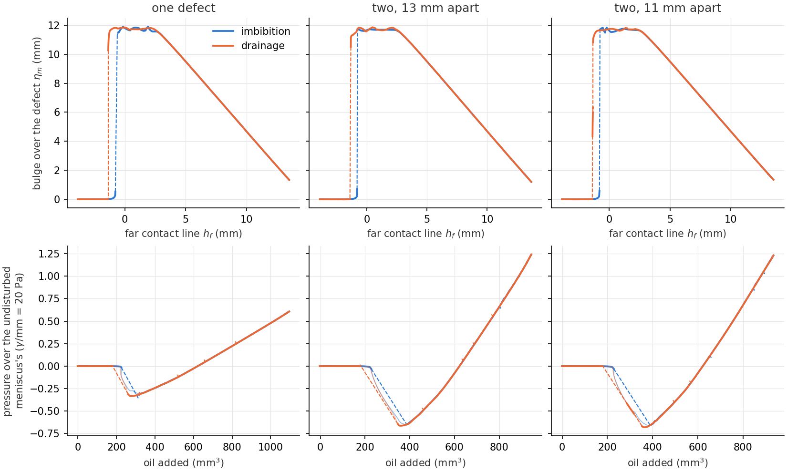
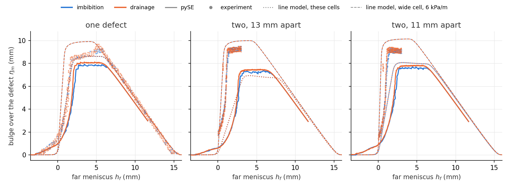

# Defects in a Hele-Shaw cell: when an interface jumps

An interface pushed slowly through a rough fracture or a porous medium does not move
smoothly: it sticks where the walls hold it and then jumps, and each jump turns some
of the work done on it into heat. That is where the hysteresis of capillary pressure
against saturation comes from. Holtzman et al. built the simplest case. In a quasi-2D
**Hele-Shaw cell**, two plates 3.6 mm apart, they printed **defects**, places 10 mm
wide where the gap narrows, and pushed silicone oil in and out of the cell by its
pressure. Each defect alone is **weak**: the interface bulges over it and back without
a jump. Their model predicts that two weak defects closer than a critical separation
act together as a **strong** one, which the interface crosses in jumps, so dissipation
emerges from units that dissipate nothing on their own. In their cell one defect
gave no hysteresis, a pair 13 mm apart (centre to centre) a loop, and a pair 11 mm
apart a wider one.

Their model treats the interface as a line in the plane of the cell. The meniscus
spans the gap, though, and where the gap narrows it does so steeply. This page builds
the cell in 3D, its upper plate a curved wall, and follows the three cases of the
experiment with pySE: the meniscus's shape across the gap, its contact lines on both
plates and gravity in the tilted cell, through imbibition and drainage.

The cell is in `docs/hele_shaw_helpers.py`, and `tools/hele_shaw_figure.py` runs it
and draws the pictures.

## The upper plate as a curved wall

The defects come from Appendix D of the paper. Along a defect's ramp, 10 mm long, the
gap b narrows so that the capillary pressure 2γ/b rises linearly by 60 Pa. A plateau
5 mm long follows at the narrowest gap, 0.56 mm, and then the gap opens back to 3.6 mm.
The printed edges are smoothed over 0.25 mm here. The upper plate is the surface
z = b(x, y), a formula in x and y, and {func}`~pysurfaceevolver.constraints.heightfield`
makes it a wall. The wetted area, the oil's volume under the plate and its weight there
have no closed form as integrals along the contact line, so `heightfield` tabulates
them over a rectangle and evaluates them in C as cubic splines, derivatives included.
The lower plate is the plane z = 0. The oil (contact angle 20°) fills the cell up to
the meniscus, and mirror planes at x = 0 and x = X stand for the rest of the cell.

Without gravity, a meniscus between parallel plates is a circular arc of radius
b/(2 cos θ). That gives a check of the curved wall. Here the defect spans the cell's
whole width, a channel 2 mm wide, and a flat meniscus is relaxed at y = -4, where the
gap is the open 3.6 mm, and at y = 12, on the plateau. The second start has the ramp
between the plates' integrals' first row (y = -12) and the meniscus, so its volume
checks the tables along the ramp:

```python
import numpy as np
from hele_shaw_helpers import cell, contact_line, gap, meniscus

for y0 in (-4.0, 12.0):                          # the open cell; the plateau
    ev = cell(None, y0, width=2.0, nx=5, gravity=False)
    y = np.linspace(-12, y0, 200001)
    b = gap(y)
    exact = 2.0*np.sum((b[1:] + b[:-1])/2*np.diff(y))     # the oil up to y0
    print(f"start at y = {y0:g}: gap {b[-1]:.4f}, volume {ev.body(1).volume:.4f} "
          f"(exact {exact:.4f})")
    ev.relax(levels=2)
    p, dry = meniscus(b[-1])
    print(f"  relaxed: pressure {ev.body(1).pressure:.4f} (exact {p:.4f}), "
          f"contact line at y = {contact_line(ev):.3f} (exact {y0 + dry/b[-1]:.3f})")
```

```text
start at y = -4: gap 3.6000, volume 57.6000 (exact 57.6000)
  relaxed: pressure -0.5225 (exact -0.5221), contact line at y = -3.086 (exact -3.082)
start at y = 12: gap 0.5625, volume 113.0703 (exact 113.0703)
  relaxed: pressure -3.3414 (exact -3.3411), contact line at y = 12.140 (exact 12.143)
```

The pressures agree to under a thousandth and the contact lines to 0.004 mm, the
error of a mesh with 24 edges across the gap. The volume agrees to every digit shown, which checks
the tables' integrals along the ramp.

## The three cells

Each run follows the experiment's cycle. A flat meniscus starts 4 mm below the defects,
and oil goes in until the meniscus far from them is 13.5 mm up (the defects end at 15);
then it is drawn back out to the start. The runs control the volume, not the
pressure: `recipes.arclength` steps the oil's volume by 12 mm³, halved at most twice
where a step finds no equilibrium, and makes the changes of topology on the way
(contact lines meeting, dry patches opening on the plate). Mirror planes bound each
cell, at x = 0 and at x = 10 for one defect, x = 14 for the pairs. The runs start from
a mesh 1.5 times finer than the tool's default (`--fine 1.5`); why is below. The three
runs:

```text
OMP_NUM_THREADS=4 python tools/hele_shaw_figure.py run single 0   --rounding 0.25 --ds 12 --halvings 2 --width 10 --fine 1.5 --states 6
OMP_NUM_THREADS=4 python tools/hele_shaw_figure.py run pair13 6.5 --rounding 0.25 --ds 12 --halvings 2 --width 14 --fine 1.5
OMP_NUM_THREADS=4 python tools/hele_shaw_figure.py run pair11 5.5 --rounding 0.25 --ds 12 --halvings 2 --width 14 --fine 1.5 --states 6
python tools/hele_shaw_figure.py draw
```



The top row follows the paper's figures: the bulge of the meniscus over the defect, η<sub>m</sub>
(the meniscus at the middle of the defect less the meniscus far from it), against
where the far meniscus is, h<sub>f</sub>, both where the meniscus meets the printed
plate (the experiment sees it otherwise: below). The bottom row shows the oil's pressure
against its volume, less the pressure of the meniscus undisturbed: a line in the
volume fitted while the defects are still far (the first 100 mm³), which takes out
gravity's steady rise. Under volume control the path is continuous. The experiment
controls the pressure, and there the interface jumps wherever the pressure would have
to fall: the dashed segments. Each jump dissipates the area it cuts off under the
pressure curve. Over the cycle, and in imbibition's jumps on the ramp (those that
start before h<sub>f</sub> reaches 4.6 mm, the top of the steep climb):

| cell | jumps (imbibition + drainage) | dissipated over the cycle | of it, imbibition on the ramp |
|---|---|---|---|
| one defect | 24 + 30 | 0.16 γ mm² (3.2 nJ) | 0.05 γ mm² |
| two, 13 mm apart | 22 + 36 | 0.35 γ mm² (6.9 nJ) | 0.10 γ mm² |
| two, 11 mm apart | 30 + 38 | 0.42 γ mm² (8.3 nJ) | 0.15 γ mm² |

All three cells share the main shape. The bulge jumps to about 1 mm as the meniscus
reaches the defect's foot (h<sub>f</sub> ≈ −1). It climbs steeply as the meniscus
rises up the ramp (h<sub>f</sub> 3.5 to 4.5), sits at 5.5–6.5 mm while the meniscus
crosses the plateau, and relaxes once the far meniscus passes the defect's end. As in
the experiment, the dissipation grows from one defect to the pair 13 mm apart to the
pair 11 mm apart, and the drainage curve parts from imbibition's where the bulge
climbs.

How much of this is the cell's and how much the mesh's shows when the mesh changes.
On the default mesh (`--fine 1`) the same runs gave 0.33, 0.41 and 0.43 γ mm² over
the cycle, most of it a sawtooth of small jumps: on the plateau, and for one defect
on the ramp (0.21 γ mm² there). Each of those jumps comes where the meniscus has
stalled and a remesh lets it go on: the contact lines hold on the mesh. On the
finer mesh one defect's jumps on the ramp fell to a quarter, while the pair 11 mm
apart's stayed (0.14 on the default mesh, 0.15 on the finer): that part is the
cell's. The finer mesh doesn't settle everything, though. A second run of the pair 13
mm apart, the same but for steps of 6 mm³ (`--ds 6`), dissipated 0.23 γ mm² over the
cycle and 0.05 on the ramp, so the numbers here carry about ±0.05 γ mm² from the
path a run happens to take: the pair 11 mm apart stands clear of one defect, the pair
13 mm apart less so. And drainage's bulge stays 0.1 mm above imbibition's across the
whole plateau in all three cells (0.12 mm on the default mesh), where the
experiment's curves lie on each other; that offset is likely the mesh's too.

### Against the experiment and the paper's theory

The experiment films the cell through its plates, and the far meniscus doesn't
stand straight across the gap. Gravity across the 3.6 mm gap (ρg cos 38° · 3.6 mm
≈ 26 Pa) outweighs the meniscus's own capillary pressure (2γ cos θ/b ≈ 10 Pa), and
the meniscus leans: where it meets the printed plate, the lower one, it runs 1.9 mm
ahead of where it crosses half the gap. In a defect, where the gap is 0.6 mm, it
hardly leans. Measured where the meniscus crosses half the gap, h<sub>f</sub> comes
out 1.9 mm smaller and the bulge 1.7 mm larger than in the figure above.



Here every curve is measured that way (`hele_shaw_helpers.half_gap` for the runs).
The dots are the experiment, read off the paper's Figs. 9b and 7
(`_static/hele_shaw_experiment.csv`); the dotted and dashed lines are the paper's
line model, below (`hele_shaw_helpers.line_model`). `draw` makes this figure too.

Measured so, one defect's bulge sits at 7.9–8.1 mm over the plateau against the
experiment's 8.5–9 mm (read off the paper's Fig. 9b), climbs about 0.5 mm of
h<sub>f</sub> later, and falls off the defect's end along the experiment's line. It
even rises a little before the meniscus reaches the defect (h<sub>f</sub> −2.5 to 0),
which the paper marks as an effect of the meniscus spanning the gap. The pairs' bulges
sit at 7.4 and 7.7 mm against about 9.2 mm in the experiment (Fig. 7).

The model of Holtzman et al. treats the meniscus as a line with a capillary length
ℓ<sub>c</sub> = √(γ/ρg<sub>e</sub>), here 1.9 mm (ρ = 930 kg/m³, γ = 20 mN/m,
g<sub>e</sub> = g sin 38°). Solved for these defects (their edges rounded as here),
following the cycle from one equilibrium to the next as h<sub>f</sub> rises and
falls:

* **In these cells.** At the slope of capillary pressure used here, the bulge over
  the plateau is 8.6, 6.9 and 8.0 mm for one defect and the pairs 13 and 11 mm apart:
  within 0.6 mm of the runs, measured where the meniscus crosses half the gap. The
  slope is Π = 6000 Pa/m as designed for oil that wets perfectly, times cos 20° for
  the contact angle used here: 5640 Pa/m.
* **In a wide cell.** The same defects in a cell 40 mm wide give 9.3, 9.4 and 9.5 mm,
  and at the experiment's 6000 Pa/m 9.9, 10.0 and 10.1 mm. In the model, the narrow
  cells here cost the pairs most (2.5 and 1.5 mm), where the "far" meniscus is only
  2.5 and 3.5 mm beyond the defects' edges. That would put the pairs' shortfall
  against the experiment down to the cells' width, but the runs don't bear the model
  out for one defect: in a cell 20 mm wide its bulge grew by 0.2 mm, where the model
  gives 0.7. A wider cell for the pairs would tell.
* **No hysteresis.** In the model one defect 10 mm wide turns strong (jumps, and a
  loop) above Π ≈ 1.20 ρg<sub>e</sub> (6710 Pa/m), the pair 13 mm apart above 1.18 and
  the pair 11 mm apart above 1.13; the narrow cells' mirror planes don't move these.
  The order is the paper's: a pair turns strong before one defect does, and the closer
  pair first. The experiment's slope is 1.07 ρg<sub>e</sub> and the slope here 1.00,
  below all three, and the line model gives no loop in any of the cells. The loops of
  the experiment's pairs, and the smaller ones here, come from what the line model
  leaves out; here some may still come from the mesh.

The pair's interaction falls off as exp(−gap/ℓ<sub>c</sub>) with the gap between the
defects' edges: 0.20 for the pair 13 mm apart (a gap of 3 mm) and 0.59 for the pair
11 mm apart (1 mm). The mirror images are far by comparison: one defect's next image
is 10 mm away edge to edge (0.005), the pairs' 5 and 7 mm (0.07 and 0.02).

Run times on 4 threads of a cluster node: 1 h 43 min for one defect, 1 h 36 min for
the pair 13 mm apart and 3 h 0 min for the pair 11 mm apart. On the default mesh they
were 39 minutes, 88 minutes and 3 h 50 min on 3 threads.

## Notes and limits

* **The finer mesh's runs stall in places.** Some descents on the finer mesh run away
  (the surface passes through itself beside a defect's rounded side edge) and the run
  backs up and tries again; once in a while it runs out of tries. One defect without
  `--states` stopped at V ≈ 256 mm³; the pair 13 mm apart with `--states` ended its
  imbibition short at V ≈ 370 mm³ and went on from a broken surface, the same way
  each time (a run resumed from its states goes on to the bit as it would have). Keeping
  states changes a run's path, and the runs above are the ones that went through.
* **Rounded edges.** The printed edges are rounded over 0.25 mm. A printed part has
  no sharp edges, and edges rounded over 0.1 mm made the runs churn for 20 minutes
  and more at each defect's side edges, where the oil wicks along the step's concave
  foot. With 0.25 mm rounding, the 1 mm channel between the defects 11 mm apart is a
  rounded groove whose roof is 3.5 mm, not 3.6.
* **Narrow cells.** Mirror planes 10 and 14 mm from the middle leave the "far"
  meniscus only 2.5 to 5 mm beyond the defects. One defect in a cell 20 mm wide (on
  the default mesh) took 2 h 25 min; its bulge over the plateau grew by 0.2 mm, and
  the offset there between drainage and imbibition halved.
* **Contact angle.** The defects were designed for oil that wets perfectly; at the 20°
  used here the capillary pressure, and its slope along the ramp, are 6% lower.
* **No contact-angle hysteresis.** The contact angle is 20° on both plates,
  advancing or receding. All the dissipation here comes from the meniscus's jumps.
* **The groove's end.** Where the 1 mm channel opens past the defects' rounded
  corners, the oil's contact line has to wrap round a corner. Each dry patch the
  descent made there moved the line by a whole edge, the line slid back, and the
  same spot was dried and wetted 52 times; the run never got past V ≈ 510 mm³. pySE
  now makes the mesh finer where a contact line on a heightfield swings like this,
  and the run goes through.
* **A remaining slow spot.** Where the meniscus first enters the 1 mm channel between
  the defects 11 mm apart (V ≈ 80 mm³), the surface crowds the mirror plane at the
  channel's middle. It took about 13 minutes there in imbibition and 30 in drainage
  on the default mesh.

## References

* R. Holtzman, M. Dentz, M. Moura, M. Chubynsky, R. Planet and J. Ortín, Emergence of
  dissipation and hysteresis from interactions among reversible, non-dissipative
  units: the case of fluid-fluid interfaces, *Phys. Rev. Fluids* 9 (2024) 064001,
  [doi:10.1103/PhysRevFluids.9.064001](https://doi.org/10.1103/PhysRevFluids.9.064001),
  [arXiv:2401.13077](https://arxiv.org/abs/2401.13077).
